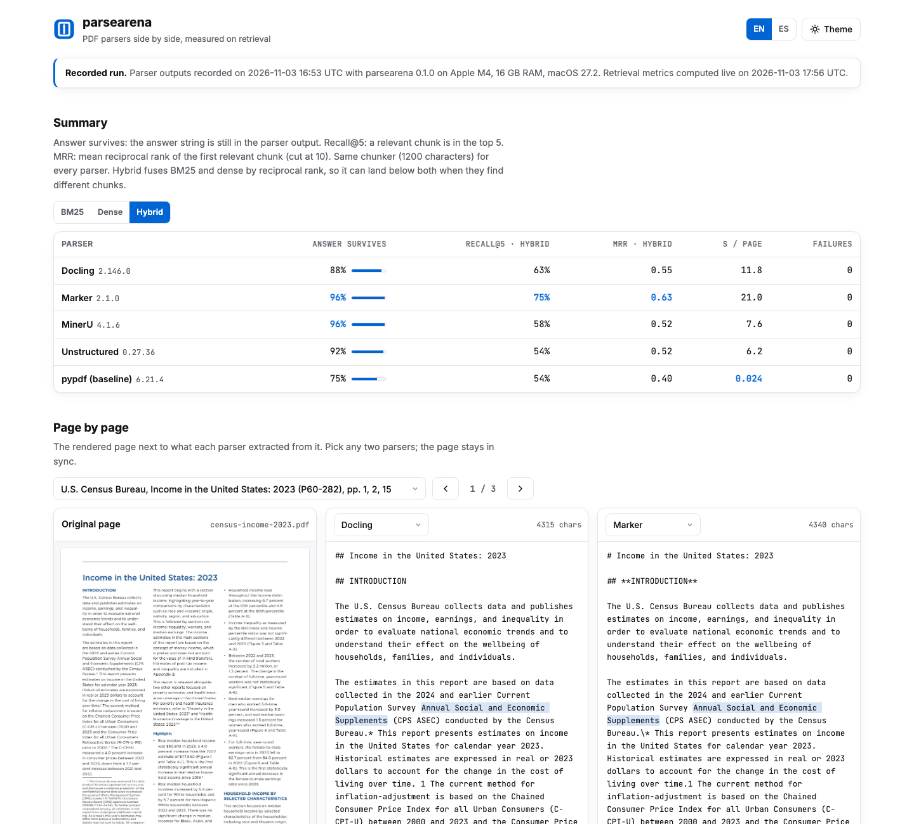
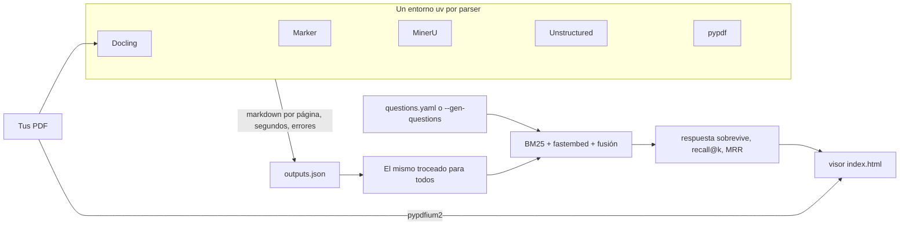

<p align="center">
  
</p>

<p align="center">
  <a href="https://github.com/diegoperezg7/parsearena/actions/workflows/ci.yml"></a>
  <a href="LICENSE"></a>
  <a href="https://github.com/diegoperezg7/parsearena/releases"></a>
  <a href="https://github.com/diegoperezg7/parsearena/stargazers"></a>
</p>

<p align="center"><b>Pasa tus PDF por Docling, Marker, MinerU y Unstructured. Compara las salidas lado a lado y mira qué le hace cada uno a la recuperación.</b></p>

<p align="center"><a href="README.md">Read in English</a> · <a href="https://diegoperezg7.github.io/parsearena/">Visor de ejemplo</a></p>

<p align="center">
  
</p>

<p align="center">
  <a href="https://diegoperezg7.github.io/parsearena/"></a>
</p>

## Por qué

Los benchmarks públicos de parsers puntúan sobre su propio corpus fijo:
[ParseBench](https://github.com/run-llama/ParseBench) (625 estrellas, de LlamaIndex) y
[OmniDocBench](https://github.com/opendatalab/OmniDocBench) (2.146 estrellas). Te dicen qué parser gana
con sus documentos, no qué pasa con *tus* facturas, papers o informes escaneados. Los arneses que
pasan varios parsers por tus propios PDF solo existen como repos con 0 estrellas (por ejemplo
[ticketvipers/pdf-parser-comparison](https://github.com/ticketvipers/pdf-parser-comparison) y
[xvalovic/document-parser-benchmark](https://github.com/xvalovic/document-parser-benchmark)).

parsearena trabaja con tus documentos. Pone la salida de cada parser junto a la página original y
mide lo que de verdad importa en un RAG: después de parsear y trocear, ¿el recuperador sigue
encontrando la respuesta?

## Inicio rápido

La demo reproduce salidas grabadas de una ejecución real y calcula la recuperación en vivo. Sin
claves, sin GPU, sin Docker y sin descargar parsers.

```bash
uvx --from git+https://github.com/diegoperezg7/parsearena@v0.1.0 parsearena demo
```

o desde un clon:

```bash
git clone https://github.com/diegoperezg7/parsearena && cd parsearena && uv run parsearena demo
```

Escribe `parsearena-demo/index.html` y lo abre. `uvx parsearena` llegará con la publicación en PyPI.

Después, con tus PDF:

```bash
parsearena run docs/*.pdf --questions preguntas.yaml
parsearena run docs/*.pdf --gen-questions              # preguntas redactadas por un modelo local de Ollama
parsearena run docs/*.pdf --parsers docling,pypdf      # cualquier subconjunto
```

## Resultado de ejemplo

Grabado el {{DATE}} en {{HW}}, tres PDF públicos (8 páginas), 24 preguntas escritas a mano,
recall@5 con recuperación híbrida (BM25 + `BAAI/bge-small-en-v1.5`, fusionados por rango recíproco):

{{TABLE}}

Lo que dicen las cifras en estas páginas:

{{FINDINGS}}

Abre el [visor de ejemplo](https://diegoperezg7.github.io/parsearena/) para comprobar cada punto contra
la imagen de la página.

## Cómo funciona



1. **Parsers aislados.** Cada parser se instala con versiones fijadas en su propio entorno virtual
   (`~/.cache/parsearena/envs`) y se ejecuta con un pequeño runner en un subproceso. Sus versiones de
   torch no chocan, sus licencias no se mezclan y parsearena no empaqueta ninguno. Todos corren con su
   configuración por defecto.
2. **Tiempos.** Cada runner convierte primero un PDF de calentamiento de dos páginas (una con texto y
   otra solo imagen) para que la carga de modelos se cuente aparte. Los segundos por página son solo
   de parseo. El dispositivo es `auto`: CUDA o MPS de Apple si torch los ve, CPU si no
   (`--device cpu` para forzarlo).
3. **Un solo troceado.** Todas las salidas pasan por el mismo empaquetador de párrafos (1.200
   caracteres por defecto, sin espacios de relleno ni reglas de tablas markdown), así que las
   diferencias vienen del parser.
4. **Recuperación.** Para cada pregunta se ordenan los fragmentos de *todos* los documentos con BM25,
   con embeddings locales ([fastembed](https://github.com/qdrant/fastembed), ONNX, sin torch) y con su
   fusión por rango recíproco. Un fragmento es relevante si es del documento de la pregunta y contiene
   la respuesta.
5. **Métricas.** *Respuesta sobrevive*: el texto de la respuesta sigue en la salida tras normalizar
   (mayúsculas, espacios, marcado markdown y HTML). *Recall@k*: hay un fragmento relevante entre los k
   primeros. *MRR*: rango recíproco del primer fragmento relevante, con corte en 10.

## Configuración

| Opción | Por defecto | Qué hace |
| --- | --- | --- |
| `--parsers` | `docling,marker,mineru,unstructured,pypdf` | Parsers a ejecutar |
| `--questions FICHERO` | | Preguntas en YAML (`parsearena questions-example` muestra el formato) |
| `--gen-questions` | no | Redacta preguntas con un LLM a partir del texto del PDF; solo guarda respuestas literales |
| `--provider` / `--model` | `ollama` / `qwen3:4b` | `ollama`, `openrouter`, `openai` o `mistral` |
| `--max-cost` | `1.0` | Tope en USD para llamadas a LLM, comprobado antes de cada llamada. Los modelos locales cuestan 0 |
| `--k` | `5` | k de recall@k |
| `--device` | `auto` | `auto`, `cpu`, `mps` o `cuda` |
| `--chunk-chars` | `1200` | Tamaño de fragmento |
| `--embed-model` / `--no-dense` | `BAAI/bge-small-en-v1.5` | Modelo de fastembed, o solo BM25 |
| `--timeout` | `3600` | Segundos por parser |
| `--out` | `parsearena-out` | Carpeta de salida (visor, `outputs.json`, `results.json`, logs) |

Variables de entorno: `OPENROUTER_API_KEY`, `OPENAI_API_KEY`, `MISTRAL_API_KEY` (solo para
`--gen-questions` con ese proveedor), `OLLAMA_HOST`, `PARSEARENA_HOME` (dónde viven los entornos) y
`LLAMA_CPP_BINARY`. Mira [.env.example](.env.example). `parsearena parsers` muestra versiones y qué
está instalado.

Fichero de preguntas:

```yaml
questions:
  - doc: informe.pdf
    q: What was the median household income in 2023?
    answer: "80,610"
  - doc: paper.pdf
    q: Which preference model makes the partition function cancel?
    answers: ["Bradley-Terry", "Bradley Terry"]
```

## Lo que cuesta una ejecución real

La primera vez, cuenta con esto:

- **Descargas.** Cada entorno de parser ocupa entre 1,1 y 1,4 GB, y el primer parseo descarga sus
  modelos de Hugging Face. En la máquina de abajo, los cuatro entornos más los modelos ocuparon unos
  {{DISK}} GB.
- **Herramientas del sistema.** La estrategia `hi_res` de Unstructured necesita `poppler` y
  `tesseract`. Marker 2.x ejecuta su modelo de OCR con llama.cpp cuando no hay GPU NVIDIA: instálalo
  (`brew install llama.cpp`) o apunta `LLAMA_CPP_BINARY` a un binario `llama-server`. parsearena avisa
  antes de ejecutar un parser al que le faltan herramientas.
- **Tiempo.** Medido en {{HW}}, con los modelos ya descargados:

{{TIMING}}

## Parsers y sus licencias

parsearena es MIT. Instala los parsers en tu máquina cuando los usas y nunca los redistribuye; sus
licencias se aplican a tu uso.

| Parser | Versión | Licencia |
| --- | --- | --- |
| [Docling](https://github.com/docling-project/docling) | 2.146.0 | MIT |
| [Marker](https://github.com/datalab-to/marker) | 2.1.0 | Código Apache-2.0. Pesos con OpenRAIL-M modificada: gratis para investigación, uso personal y startups de menos de 5 M USD |
| [MinerU](https://github.com/opendatalab/MinerU) | 4.1.6 | Apache-2.0 con términos extra: licencia comercial por encima de 100 M de usuarios activos al mes o 20 M USD de ingresos mensuales, y atribución en servicios online |
| [Unstructured](https://github.com/Unstructured-IO/unstructured) | 0.27.36 (`hi_res`) | Apache-2.0 |
| [pypdf](https://github.com/py-pdf/pypdf) (línea base) | 6.21.4 | BSD-3-Clause |

MinerU corre con su esfuerzo `medium` (modelos locales de layout, OCR, tablas y fórmulas, sin modelo de
visión y lenguaje) y con su telemetría desactivada (`MINERU_TELEMETRY_DISABLED=1`). parsearena no tiene
telemetría.

## Documentos de la demo

| Fichero | Páginas | Licencia |
| --- | --- | --- |
| [U.S. Census Bureau, *Income in the United States: 2023* (P60-282)](https://www.census.gov/library/publications/2024/demo/p60-282.html) | 1, 2 (gráfico), 15 (tabla A-1) | Dominio público (obra del gobierno de EE. UU.) |
| [Rafailov et al., *Direct Preference Optimization* (arXiv:2305.18290v3)](https://arxiv.org/abs/2305.18290) | 1, 4, 5 (ecuaciones), 9 (tabla) | [CC BY 4.0](https://creativecommons.org/licenses/by/4.0/) |
| [NACA Report 1135, *Equations, Tables, and Charts for Compressible Flow* (1953)](https://ntrs.nasa.gov/citations/19930091059) | p. 613, rasterizada a página solo imagen | Dominio público (obra del gobierno de EE. UU.) |

Las páginas se extrajeron sin cambios, salvo la de NACA, que se volvió a renderizar como imagen para
que no tenga capa de texto, como un escaneo real. Las preguntas están en
[`src/parsearena/demo/questions.yaml`](src/parsearena/demo/questions.yaml).

## Hoja de ruta

- Parsers en la nube: LlamaParse, Mistral OCR, Azure Document Intelligence
- Parsers con modelos de visión y lenguaje (y los esfuerzos VLM de MinerU)
- Métricas de estructura de tablas (TEDS)
- Entrada docx y pptx

## Licencia

[MIT](LICENSE). Las contribuciones son bienvenidas, mira [CONTRIBUTING.md](CONTRIBUTING.md).
