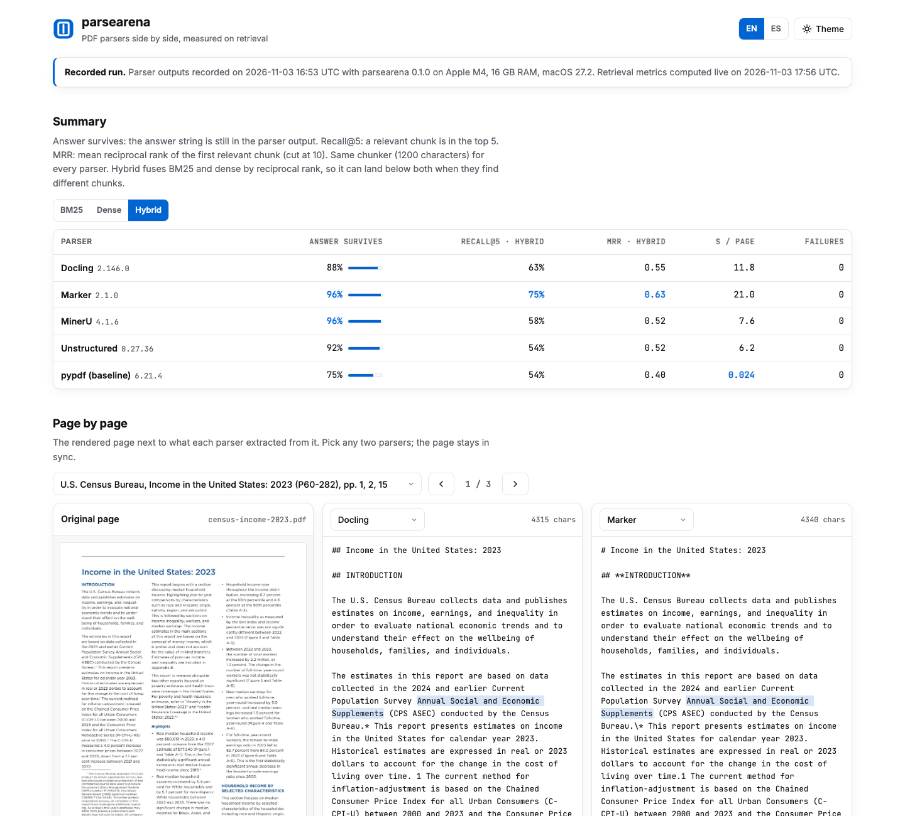
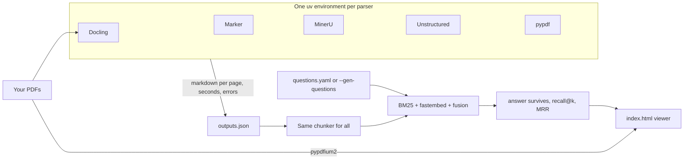

<p align="center">
  
</p>

<p align="center">
  <a href="https://github.com/diegoperezg7/parsearena/actions/workflows/ci.yml"></a>
  <a href="LICENSE"></a>
  <a href="https://github.com/diegoperezg7/parsearena/releases"></a>
  <a href="https://github.com/diegoperezg7/parsearena/stargazers"></a>
</p>

<p align="center"><b>Run your PDFs through Docling, Marker, MinerU and Unstructured. Compare the output side by side and see what each one does to retrieval.</b></p>

<p align="center"><a href="README.es.md">Leer en español</a> · <a href="https://diegoperezg7.github.io/parsearena/">Example viewer</a></p>

<p align="center">
  
</p>

<p align="center">
  <a href="https://diegoperezg7.github.io/parsearena/"></a>
</p>

## Why

Public parser benchmarks score parsers on their own fixed corpus:
[ParseBench](https://github.com/run-llama/ParseBench) (625 stars, by LlamaIndex) and
[OmniDocBench](https://github.com/opendatalab/OmniDocBench) (2,146 stars). That tells you which parser
wins on their documents. It does not tell you what happens to *your* invoices, papers or scanned
reports. Harnesses that run several parsers on your own PDFs exist only as 0-star repositories
(for example [ticketvipers/pdf-parser-comparison](https://github.com/ticketvipers/pdf-parser-comparison)
and [xvalovic/document-parser-benchmark](https://github.com/xvalovic/document-parser-benchmark)).

parsearena works on your documents. It shows each parser's output next to the original page, and it
measures the thing you actually care about in a RAG pipeline: after parsing and chunking, can the
retriever still find the answer?

## Quickstart

The demo replays outputs recorded from a real run and computes retrieval live. No keys, no GPU,
no Docker, no parser downloads.

```bash
uvx --from git+https://github.com/diegoperezg7/parsearena@v0.1.0 parsearena demo
```

or from a clone:

```bash
git clone https://github.com/diegoperezg7/parsearena && cd parsearena && uv run parsearena demo
```

It writes `parsearena-demo/index.html` and opens it. `uvx parsearena` is coming to PyPI.

Then run it on your own PDFs:

```bash
parsearena run docs/*.pdf --questions questions.yaml
parsearena run docs/*.pdf --gen-questions              # questions drafted by a local Ollama model
parsearena run docs/*.pdf --parsers docling,pypdf      # any subset
```

## Example output

Recorded on {{DATE}} on {{HW}}, three public PDFs (8 pages), 24 hand-written questions,
recall@5 with hybrid retrieval (BM25 + `BAAI/bge-small-en-v1.5`, fused with reciprocal rank):

{{TABLE}}

What the numbers say on these pages:

{{FINDINGS}}

Open the [example viewer](https://diegoperezg7.github.io/parsearena/) to check each of these against
the page image.

## How it works



1. **Isolated parsers.** Each parser is installed with pinned versions into its own virtual
   environment under `~/.cache/parsearena/envs` and driven through a small runner script in a
   subprocess. Their torch versions never meet, their licenses stay separate, and parsearena never
   bundles any of them. Every parser runs with its default settings.
2. **Timing.** Each runner first converts a two-page warm-up PDF (one text page, one image-only page)
   so that model loading is reported apart. The seconds per page in the table are parsing only.
   Device is `auto`: CUDA or Apple MPS when torch sees them, CPU otherwise (`--device cpu` to force).
3. **One chunker.** Every output goes through the same paragraph packer (1,200 characters by default,
   padding spaces and markdown table rules removed), so differences come from the parser.
4. **Retrieval.** For each question, chunks from *all* documents are ranked with BM25, with local
   embeddings ([fastembed](https://github.com/qdrant/fastembed), ONNX, no torch) and with their
   reciprocal-rank fusion. A chunk is relevant if it belongs to the question's document and contains
   the answer string.
5. **Metrics.** *Answer survives*: the answer string is still in the parser output after
   normalization (case, whitespace, markdown and HTML markup). *Recall@k*: a relevant chunk is in the
   top k. *MRR*: reciprocal rank of the first relevant chunk, cut at 10.

## Configuration

| Option | Default | What it does |
| --- | --- | --- |
| `--parsers` | `docling,marker,mineru,unstructured,pypdf` | Parsers to run |
| `--questions FILE` | | YAML question set (`parsearena questions-example` prints the format) |
| `--gen-questions` | off | Draft questions with an LLM from the PDF text layer; keeps only answers found verbatim |
| `--provider` / `--model` | `ollama` / `qwen3:4b` | `ollama`, `openrouter`, `openai` or `mistral` |
| `--max-cost` | `1.0` | USD cap for LLM calls, checked before every call. Local models cost 0 |
| `--k` | `5` | k for recall@k |
| `--device` | `auto` | `auto`, `cpu`, `mps` or `cuda` |
| `--chunk-chars` | `1200` | Chunk size |
| `--embed-model` / `--no-dense` | `BAAI/bge-small-en-v1.5` | fastembed model, or BM25 only |
| `--timeout` | `3600` | Seconds per parser |
| `--out` | `parsearena-out` | Output directory (viewer, `outputs.json`, `results.json`, logs) |

Environment variables: `OPENROUTER_API_KEY`, `OPENAI_API_KEY`, `MISTRAL_API_KEY` (only for
`--gen-questions` with that provider), `OLLAMA_HOST`, `PARSEARENA_HOME` (where environments live),
`LLAMA_CPP_BINARY`. See [.env.example](.env.example). `parsearena parsers` lists pinned versions and
what is installed.

Questions file:

```yaml
questions:
  - doc: report.pdf
    q: What was the median household income in 2023?
    answer: "80,610"
  - doc: paper.pdf
    q: Which preference model makes the partition function cancel?
    answers: ["Bradley-Terry", "Bradley Terry"]
```

## What a real run costs

Be ready for this the first time:

- **Downloads.** Each parser environment is 1.1 to 1.4 GB, and the first parse downloads its models
  from Hugging Face. On the machine below, the four parser environments plus models took about
  {{DISK}} GB of disk.
- **System tools.** Unstructured's `hi_res` strategy needs `poppler` and `tesseract`. Marker 2.x runs
  its OCR model through llama.cpp when there is no NVIDIA GPU: install it (`brew install llama.cpp`)
  or point `LLAMA_CPP_BINARY` at a `llama-server` binary. parsearena warns before running a parser
  whose tools are missing.
- **Time.** Measured on {{HW}}, with the models already downloaded:

{{TIMING}}

## Parsers and their licenses

parsearena is MIT. It installs the parsers on your machine on demand and never redistributes them;
their licenses apply to your use of them.

| Parser | Version | License |
| --- | --- | --- |
| [Docling](https://github.com/docling-project/docling) | 2.146.0 | MIT |
| [Marker](https://github.com/datalab-to/marker) | 2.1.0 | Code Apache-2.0. Model weights under a modified OpenRAIL-M: free for research, personal use and startups under 5M USD |
| [MinerU](https://github.com/opendatalab/MinerU) | 4.1.6 | Apache-2.0 with extra terms: a commercial license above 100M monthly active users or 20M USD monthly revenue, and attribution for online services |
| [Unstructured](https://github.com/Unstructured-IO/unstructured) | 0.27.36 (`hi_res`) | Apache-2.0 |
| [pypdf](https://github.com/py-pdf/pypdf) (baseline) | 6.21.4 | BSD-3-Clause |

MinerU runs at its `medium` effort (local layout, OCR, table and formula models, no vision-language
model) with its telemetry disabled (`MINERU_TELEMETRY_DISABLED=1`). parsearena itself has no telemetry.

## Demo documents

| File | Pages used | License |
| --- | --- | --- |
| [U.S. Census Bureau, *Income in the United States: 2023* (P60-282)](https://www.census.gov/library/publications/2024/demo/p60-282.html) | 1, 2 (chart), 15 (Table A-1) | Public domain (U.S. government work) |
| [Rafailov et al., *Direct Preference Optimization* (arXiv:2305.18290v3)](https://arxiv.org/abs/2305.18290) | 1, 4, 5 (equations), 9 (table) | [CC BY 4.0](https://creativecommons.org/licenses/by/4.0/) |
| [NACA Report 1135, *Equations, Tables, and Charts for Compressible Flow* (1953)](https://ntrs.nasa.gov/citations/19930091059) | p. 613, rasterized to an image-only page | Public domain (U.S. government work) |

The pages were extracted unchanged, except the NACA page, which was re-rendered as an image so that it
has no text layer, like a real scan. The question set is in
[`src/parsearena/demo/questions.yaml`](src/parsearena/demo/questions.yaml).

## Roadmap

- Cloud parsers: LlamaParse, Mistral OCR, Azure Document Intelligence
- Vision-language model parsers (and MinerU's VLM efforts)
- Table structure metrics (TEDS)
- docx and pptx input

## License

[MIT](LICENSE). Contributions welcome, see [CONTRIBUTING.md](CONTRIBUTING.md).
